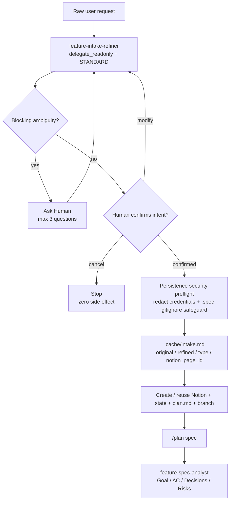
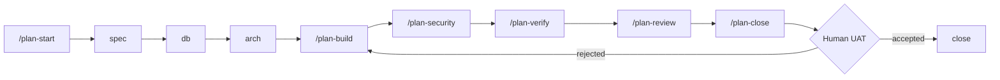
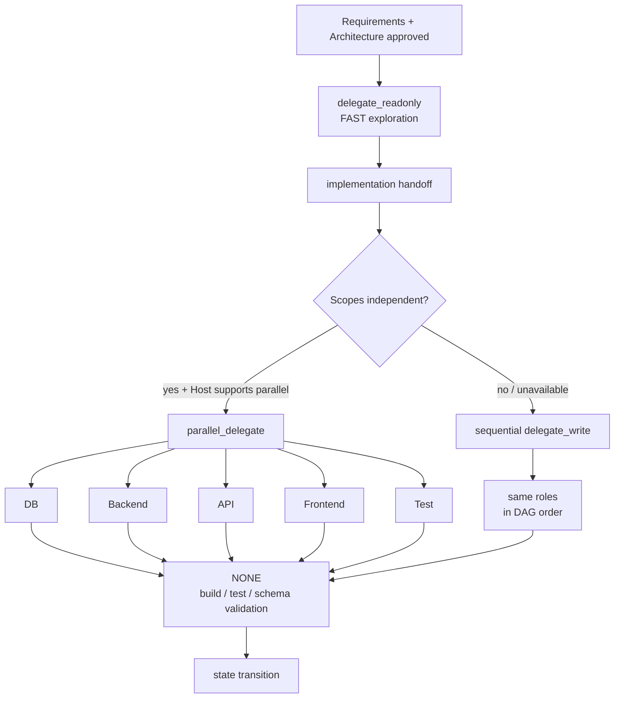
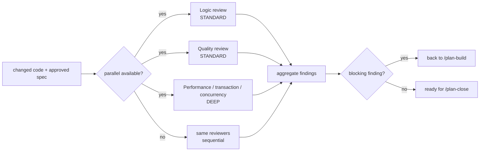
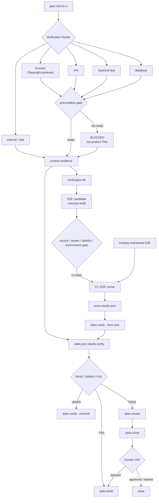

# Feature Workflow Plugin `v5.3.0`

跨 Host 的 Feature lifecycle：本地 `.spec/` 規劃、Human approval gates、正式實作、安全/驗證/review、Human UAT 與結案同步。核心 contract 不依賴單一 Host 的 team、subagent 或 provider model 名稱。

## 安裝

### Claude Code

```bash
claude plugin marketplace add mark22013333/crew
claude plugin install feature-workflow
```

### Codex

```bash
codex plugin marketplace add mark22013333/crew
codex plugin add feature-workflow@crew
```

首次使用執行 `/plan-setup`；若 Bug workflow 也安裝，建議先跑 `/bug-setup`，Feature setup 可重用共用 Notion metadata。

## 更新

若同時安裝 `bug-workflow`，可直接用統一入口：

```text
/crew-upgrade
/crew-upgrade --check
```

若只安裝 Feature plugin，使用 Host-native 更新：

### Claude Code

```bash
claude plugin marketplace update company-marketplace
claude plugin update feature-workflow@company-marketplace
claude plugin list
```

### Codex

```bash
codex plugin marketplace upgrade crew
codex plugin list
```

更新後開新 session。若 Codex marketplace 尚未註冊，先執行 `codex plugin marketplace add mark22013333/crew`。

---

## Intake refinement

`/plan-start` 在任何 Notion / `.spec` / Git side effect 前，先用唯讀 `feature-intake-refiner` 把 raw request 整理成短標題與 task brief，再由 Human 明確確認。Bug plugin 也依同一 shared contract 使用 `bug-intake-refiner`；兩者都不是 Slash Skill。

<!-- crew:diagram intake-refinement-flow -->


責任分界與 durability：

- Intake Refiner：回答「使用者到底想做什麼？」；不產 AC、不做 DB/API/架構設計。
- Human：確認 refined intent；沉默不算核准。
- persistence 前若疑似含 credential，先要求 Human 提供 redacted 版本；不把 secret 寫進 cache / Notion / plan.md / state。
- Git repo 內建立 cache/state 前先確認 `.spec/` 已被 `.gitignore` 保護。
- `feature-spec-analyst`：task 建立後才把 confirmed brief 工程化成 Goal / AC / Decisions / Risks。
- Notion「📋 需求描述」永久保存 raw original + confirmed refined brief；plan.md 只保留 refined brief。
- Plan intake cache 是 page-aware recovery journal，保存 `notion_page_id`；Notion create 成功後先 journal page ID，再 init state。
- 重跑遇到 matching pending task 會先詢問是否沿用；cache 有 page ID 時 fetch/沿用，不建立 duplicate page。
- `/plan-sync` 會 reconcile cache/page/state 後補建/補寫；只有 state/page/intake 全部一致才刪 cache。`/plan-close` 發現 cache/state page ID 衝突會 BLOCK。
- `/plan-start`、`/plan-sync`、`/plan-close` 呼叫 CREW scripts 時都先解析 `CREW_PLUGIN_ROOT`；不直接依賴 Claude marketplace/cache path。
- Shared intake contract 同時定義 Bug durable recovery；Bug cache 必須在 intake headings + 五個標準 Bug sections 全部 fetch 驗證完成後才可刪除，只有 headings 完整仍不夠。Feature plugin 保留同步副本是為了兩個 plugin 都可獨立安裝且 contract 不漂移。

完整 contract 見 [references/intake-refinement.md](references/intake-refinement.md)。

---

## Feature lifecycle

<!-- crew:diagram feature-lifecycle -->


Runtime steps：

```text
start → spec → db → arch → build → security → verify → review → close
```

`.spec/{slug}/state.json` 是唯一流程狀態，唯一寫者為 `scripts/crew-state.py`。

### Approval gates

- Requirements 未核准：不得往 DB/arch/build。
- Architecture 未核准：不得進 build。
- `verify=PASS` 或 review 完成：**不等於 Human UAT approved**。
- `/plan-close` 是 Feature UAT + close 的合法入口；每次結案前都重新取得本輪 Human decision。
- 快速結案：簡單功能可在 `/plan-close` 由人類明確同意後，把未完成的 security／verify／review 標 `skipped`（`--by human --reason` 必填，且需 build 已完成、requirement／architecture 閘已通過，runtime 會擋）；Human UAT 與漂移硬關卡不因此略過。

---

## `.spec/` 結構

v2 task 的核心檔案：

```text
.spec/{slug}/
├── plan.md       # goal / AC / decisions / risks / map / report anchors
├── state.json    # machine state；唯一寫者 crew-state.py
└── deploy.sql    # 有 DB migration 時才存在
```

`files.md`、`log.md`、`handoff.md`、`.spec/_index.md` 等 v1 artifact 不再是 v2 runtime contract。Notion intake 尚未成功持久化時可暫存 `.spec/{slug}/.cache/intake.md`；它 gitignored、同步成功後刪除，不是永久 runtime artifact。

---

## Host Capability Contract

Feature workflow 用 capability 描述角色，不要求某個 Host 一定有 team/multi-agent：

| Capability | 用途 | 無該 Host 能力時 |
|---|---|---|
| `project_instructions` | 讀 `AGENTS.md` / `CLAUDE.md` | 無任何指令檔才阻擋 |
| `delegate_readonly` | spec、探索、review | 主 Agent inline 唯讀執行 |
| `delegate_write` | 已核准的正式實作 | 主 Agent 按 allowed scope 寫入 |
| `parallel_delegate` | 互不依賴角色加速 | sequential fallback |
| `tool_probe` | DB/瀏覽器等外部能力 | no-tool fallback |
| `ask_user` | requirements / architecture / UAT decision | 一般對話詢問 |

因此平行執行是最佳化，不是 `/plan-build` 或 `/plan-review` 的 hard prerequisite。

完整 contract 見 [references/host-capabilities.md](references/host-capabilities.md)。

---

## Model Routing

Feature workflow 使用 provider-neutral profiles：

| 工作 | Profile | 可改產品碼 |
|---|---|---|
| repository search、範本/交叉引用探索 | `FAST` | 否 |
| 一般需求分析與一般 review | `STANDARD` | 否 |
| DB schema / architecture / security / performance | `DEEP` | 否 |
| build/test/schema validation | `NONE` | 否 |
| `/plan-build` 正式實作 | `DEEP`（目前保守基準） | **是** |

Profile 由 `crew-model-route.py` + `model-routing.json` 計算，Host adapter 才決定實際 provider mapping。Workflow README 不把 provider model 名稱當成流程契約。

---

## Portable Config

CREW-owned Feature config 由 shared resolver 管理，不由 README 指定 Host-specific directory。

Portable root：

1. `CREW_CONFIG_HOME`
2. `$XDG_CONFIG_HOME/crew`
3. `~/.config/crew`

主要 logical keys：

| Key | 用途 |
|---|---|
| `feature/config` | Notion IDs、workspace metadata、欄位對照 |
| `feature/project` | repo-id 專案對應 |
| `feature/stack` | 自訂 stack definition |
| `bug/config` | setup 時可讀取共用 Notion metadata |

`scripts/crew-config.py` 負責 canonical path、legacy read fallback 與 representation；新寫入永遠走 portable root。Feature project / stack 的 standalone file 依 logical key 解析，不直接硬編碼某個 Host home path。

---

## 專案指令

需要專案架構與規範時使用 `project_instructions`：

- `AGENTS.md`
- `CLAUDE.md`

兩者並存時都可讀；若內容衝突，必須保留歧義讓 Human 決定。

---

## Skill 清單

| Skill | 說明 |
|---|---|
| `/plan-setup` | 建立/更新 Feature portable config |
| `/plan-stack` | 掃描專案並建立自訂 stack definition |
| `/plan-start <任務>` | Refine raw request → Human confirm → 建立 Notion + `.spec/` + Git branch；`--from-review-once --proof dialogue\|signed` 供 `/plan-run` 以已核准 packet 建任務 |
| `/plan-explore` | 想法探索、問題調查、方案比較 |
| `/plan-browse` | 深讀/比較既有規劃 |
| `/plan [spec\|db\|arch]` | 三 pass 規劃與 approval loop；spec pass 先問 Sxx 行為案例深度（`--scenarios none\|risky\|all` 可跳過詢問，不是預設） |
| `/plan-build` | 依核准規格執行正式實作；支援 dry-run / scoped build；第 4 步測試策略三選一（不產測試／一般測試／BDD Test-First，無隱含預設），`--bdd` 先寫 Sxx 測試取 RED 再實作取 GREEN、開工前確認 runner／路徑／Sxx |
| `/plan-run` | 先問推進方式：互動逐站／同 session 一次審查連跑（核准一次 packet 後在本對話連跑到 build 或 arch，**不是無人值守**）／trusted-host 簽章；子指令 `status\|pause\|resume\|revoke\|reclaim` |
| `/plan-security` | 安全審查 |
| `/plan-verify` | Browser/API 驗證、evidence、Word/Excel/E2E 選項 |
| `/plan-review` | 邏輯、品質、效能 review；可 quick |
| `/plan-close` | Human UAT + 結案同步 |
| `/plan-sync` | 中途同步 `.spec/` 到 Notion |
| `/plan-deploy-confirm` | 部署 SQL step 回報 |
| `/plan-status` | 查看任務狀態；v1 可 migrate |
| `/plan-next` | 從 state 計算下一步 |
| `/plan-drift` | `plan.md` anchor / code drift 檢查 |
| `/plan-demo` | 純本地評估模式 |
| `/crew-cockpit` | 開啟 CREW Cockpit Pane（總覽／任務／驗收，唯讀；僅 Claude Code ≥ 2.1.289） |

---

## `/plan-run`：先問要怎麼推進（三種模式）

此 Skill 適用於想減少逐步確認的 **Feature Workflow**。預設的 `/plan-start → /plan → /plan-build` 仍保持 Interactive；Review Once **不支援 Bug Workflow，也不授權自動 UAT、部署或 Git merge**。

無旗標時先以結構化提問問「要用哪種方式推進這個 Feature？」——**只有本輪明確選擇才算**，沉默、Enter、「繼續」一律重問；旗標是跳過詢問的捷徑，不是預設。無法提問的 headless 環境（權限提示關閉、排程、`claude -p` 非互動）旗標不齊一律 BLOCK 並列出缺少的旗標。

```text
/plan-run                                   # 無旗標：先問三種模式
/plan-run --mode interactive                # 1. 互動逐站
/plan-run --mode session --until build --max-duration 4h --test with_test   # 2. 同 session（review-once 為別名）
/plan-run --mode trusted-host               # 3. 需工作區外簽章 Host 與受保護 adapter
/plan-run status | pause | resume | revoke | reclaim
```

### 模式 1：互動逐站

只讀 state 並回報 `/plan-next` 建議的下一步，不派工、不建立 grant；每站的 Approval Gate 照既有 `/plan`／`/plan-build` 由 Human 核准。

### 模式 2：同 session 一次審查連跑（建議；**不是無人值守**）

1. 第二層一次問三題：跑到哪一站（`--until build|arch`）、時限（`--max-duration 4h|2h|1h`）、測試策略（`--test with_test|bdd`；選 bdd 時 packet 必須含 Sxx）。`git commit` 不問、固定不允許。
2. CREW 以唯讀探索準備整份 Review Packet（Spec、AC／Sxx、DB SQL、Architecture、允許修改的路徑、測試策略、禁止動作、`packet_sha256`），展示後問核准題：核准並連跑／修改重產（舊 sha 作廢）／取消（零 side effect）。
3. 核准後 `/plan-start --from-review-once --proof dialogue` 以 `review-once-packet.py verify` 驗 hash 建任務，再 `crew-state.py grant --action issue --proof dialogue` 綁定；**時限從這一刻起算**。
4. 主對話迴圈依 `crew-state.py run --action next` 連跑 Spec → DB → Arch（`review-once-apply.py --step X`）→ Build（`/plan-build --with-test|--bdd --review-once`），到 `completed_build` 或 `--until arch` 的 `completed_plan` 結束。
5. 停止點（TEST_FAILED／E0-E3／E8、NEED_HUMAN、範圍衝突、到期）都以編號選項問 Human，**不提供「跳過」**。

**誠實定位**：dialogue grant 的 packet hash 只保證「套用的＝審過的」，信任等級等同 Interactive 的 `gate --by human`，**不是不可偽造的核准**。迴圈在目前對話裡同步執行，session 結束即 paused，`/plan-run resume` 續跑；原 session 已死而 Runner 仍 `running` 時先 `/plan-run reclaim`（running→paused、`SESSION_LOST`），再經「原 worker 已停止？」確認後接管。Claude Code／Codex 的一般 CLI 都可用此模式，但不得稱為無人值守。

### 模式 3：trusted-host 簽章（Host Bridge）

需要 Host 在**工作區外**提供受保護的 Human approval 簽章端與 worker adapter；入口會多問一題要求 adapter 絕對路徑並確認四項 `host_guarantees`（`protected_human_approval`／`enforced_write_scope`／`worker_cancellation`／`no_unattended_escalation`）已由 Host 實際實施——這是人工確認，不是密碼學證明。普通 `claude -p`、`codex exec` 或把 `host_guarantees` 設為 `true` **不等於具備這些能力**，請改用模式 2。

packet 經 Host 簽署（`approval.json`＋`approval.sig`）後，以 `/plan-start --from-review-once --packet … --event … --signature …` 建任務並綁定 `signed` grant（時限自 Host 簽發事件的 `issued_at` 起算，≤4h），再由 Bridge 同步派工（`{slug}` 和路徑為示意）：

```bash
CREW_PLUGIN_ROOT="${PLUGIN_ROOT:-${CLAUDE_PLUGIN_ROOT:-}}"

# 僅檢查設定檔契約；通過不代表 Host 沙箱已驗證
python3 "${CREW_PLUGIN_ROOT}/scripts/review-once-host.py" \
  --project . --slug {slug} \
  --adapter /host-managed/review-once-adapter.json --action probe

# 同步執行至 Build Done、暫停或 Grant 到期；worker 輸出寫到 .cache 供事後檢視
python3 "${CREW_PLUGIN_ROOT}/scripts/review-once-host.py" \
  --project . --slug {slug} --owner {host-runner-id} \
  --adapter /host-managed/review-once-adapter.json --action start \
  --worker-log .spec/{slug}/.cache/review-once-worker-{run_id}.log

# 可從另一個終端查詢目前已保存的進度（含 grant_proof、target_step）
python3 "${CREW_PLUGIN_ROOT}/scripts/review-once-host.py" \
  --project . --slug {slug} --action status
```

Bridge **只接受 `signed` grant**，對 `dialogue` grant 一律 BLOCK；它是同步執行器，Host Session 結束後不會自行在背景接手。`status` 只顯示 Runner checkpoint，不保證 Worker 此刻仍在執行；中斷後必須先確認原 Worker **確實停止**，才可用 `resume --reconcile --reason "已確認原工作程序結束"`，不得直接重複派工。

### 共同邊界

- 授權只涵蓋當時那一份完整 packet；AC／架構／scope 有任何改變就要重產 packet 重審，不得沿用舊 grant。
- 時限上限 4 小時且自 grant 簽發起算，暫停／續跑不延長；到期只能重審新 packet 或轉 Interactive。
- Build 完成後停止；`/plan-security`、`/plan-verify`、`/plan-review` 與 **Human UAT** 仍需另外執行，且不能由 grant 代核准。

詳細文件：[Review Packet](references/review-once.md)、[Grant／Gate（含 dialogue 節）](references/review-once-grants.md)、[Runner／Pause／Resume／Reclaim](references/review-once-runner.md)、[Host Bridge 安全與設定](references/review-once-host.md)。

---

## `/plan-build` 執行模型

`/plan-build` 仍採「先探索、再按角色實作」的分工，但角色是 capability contract，不是某一種 Host team API：

<!-- crew:diagram plan-build-orchestration -->


1. 唯讀探索：找相關檔案、現有範本、介面與影響範圍。
2. 將核准 spec + 探索 handoff 拆成 DB/backend/API/frontend/test 等必要角色。
3. Host 能平行且 scope 互斥時可 parallel delegate。
4. Host 無平行能力時依 DAG sequential 執行。
5. 每個可寫角色都限制 allowed paths；完成後跑 deterministic build/test。
6. 不允許因為 Host 能力較少而跳過 approval、scope 或 verification。

---

## `/plan-review` 執行模型

Review 以邏輯、品質、效能/交易/並行等角度拆開：

<!-- crew:diagram plan-review-orchestration -->


- 各 reviewer 預設唯讀。
- 可平行時平行，不可平行時 sequential。
- 安全審查由 `/plan-security` 負責，不與一般 review 混為同一 gate。
- 小變更可使用 `/plan-review --quick`。

---

## `/plan-verify`

`/plan-verify` 產出 machine/browser evidence，而不是 Human UAT 本身。

<!-- crew:diagram plan-verify-flow -->


可依環境使用：

- Verification Router：Browser / API / backend-test / database / manual
- Browser 驗收（Playwright preferred；chrome-devtools / local CDP fallback）
- `BLOCKED`：前置條件不成立，不誤報產品 FAIL
- `--recheck`：重跑 FAIL + BLOCKED
- `--e2e`：重用既有 E2E coverage
- `--e2e-draft`：由 Verification IR 產出 draft candidate
- `--e2e-promote`：通過 source/review/stability/fingerprint/environment gate 後才可 ci-ready
- `--from-e2e`：消費 `crew-results.json`，不重新開瀏覽器
- Excel report
- Word report

> E2E candidate 預設為 `draft`；只有通過 deterministic promotion gate，且 environment gate 不為 deferred，才可標示 `ci-ready`。

外部 browser/DB 工具以 `tool_probe` 判斷目前 Host 是否真的可呼叫；不能用某一家 CLI listing 代替 capability probe。

Project verify memory canonical storage 是 `.crew/verify-memory.md`；舊 `.claude/verify-memory.md` 只在 canonical 不存在時相容讀取。驗證結果仍以 `state.json.results.verify` 為唯一 machine truth。

流程邊界：`verify PASS` → `/plan-review` → `/plan-close`；**Human UAT 在 `/plan-close` 內取得**，不是 `/plan-verify` 的副作用。

---

## CREW Cockpit（Claude Code Mod）

Claude Code 專屬的唯讀儀表板，隨 feature-workflow 一起安裝：

- **AbovePrompt HUD**：輸入框上方顯示目前任務 slug、phase、verify 狀態、停滯天數與其他進行中任務數；沒有任務時不佔版面。
- **`/crew-cockpit` Pane**：總覽儀表板、任務列表／卡片切換、驗收頁；資料全部來自 `.spec/*/state.json` 與驗證結果，只讀、不修改。
- **Fill 只填入、不送出**：按鈕只會把下一步指令填進輸入框，由你自己按 Enter。
- **最低版本** Claude Code 2.1.289；Codex 等其他 Host 的 CREW 核心流程照常運作，但沒有 Mod UI。
- **測試開發中的 Mod**：只能用 terminal 的 `claude --plugin-dir <路徑>`；Claude Desktop 不吃 `CLAUDE_CODE_PLUGIN_DIRS`，需安裝後才看得到。
- 已知問題：殘留的 `plugins/feature-workflow/.claude-plugin/marketplace.json`（4.24.3）與 `category` 欄位會讓 `claude plugin validate --strict` 失敗（main 既有，尚未處理）。

---

## SessionStart hook

Claude Code adapter 會以 `crew-state.py session-brief` 顯示未完成任務與 `/plan-next`。Hook 只讀當前 repo 的 state，不外送、不修改產品檔案，錯誤時不阻擋 session。

沒有同等 session hook 的 Host 直接使用 `/plan-next` 即可，不影響 workflow correctness。

---

## v1 compatibility

v1 任務目前仍可相容完成或用 `/plan-status --migrate <slug>` 做機械遷移。`feature-workflow@5.1.0` 已達原訂 removal eligibility 的版本門檻，但本版**刻意保留 v1 compatibility**；真正移除 `legacy-v1.md` / migrate path 必須另開 breaking-change PR／release。

Removal eligibility：

- `feature-workflow@5.1.0+` 發布；或
- `2026-10-26`

以先到者為準。門檻未達前不得提前刪 v1 compatibility surface。

詳見 [references/legacy-v1.md](references/legacy-v1.md)。

---

## 與 Bug Workflow 的關係

- 共用 Notion 任務/專案 metadata。
- `/project-add` 維護 shared `feature/project` mapping。
- 共用 Host Capability、Model Policy、State Discipline、Portable Config Contract。
- Bug 與 Feature lifecycle 各自 type-aware，不用 Feature phases 模擬 Bug。

## 設計參考

- [Host Capability Contract](references/host-capabilities.md)
- [Model Policy](references/model-policy.md)
- [State Discipline](references/state-discipline.md)
- [Portable Config Contract](references/config-contract.md)
- [Config Resolver](references/config-resolver.md)
- [UAT Gate](references/uat-gate.md)
- [Verify Memory Contract](references/verify-memory.md)
- [Intake Refinement Contract](references/intake-refinement.md)

## 授權

MIT License
